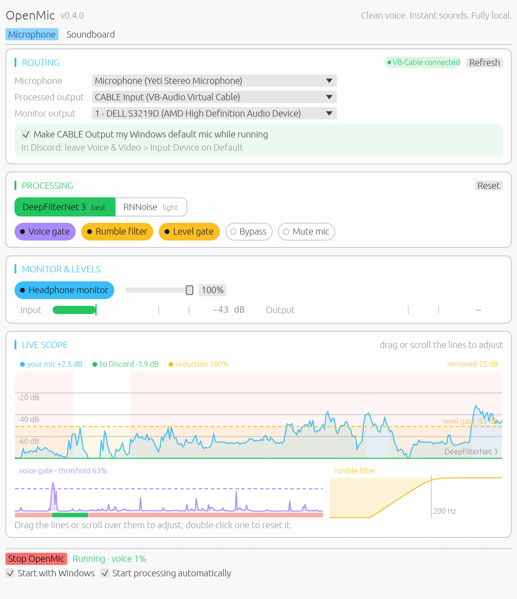

# OpenMic

OpenMic is a local, real-time microphone cleaner and soundboard for Windows. It cleans your voice with DeepFilterNet 3 (or the lighter RNNoise), silences everything that isn't speech, mixes optional sound clips, and sends the result to VB-Audio Virtual Cable for Discord or any other voice application.

Audio stays on your computer. Nothing is recorded unless you use **Record** or speech to text, and nothing is uploaded. The only network requests are the speech model download you ask for and a daily check for new OpenMic releases, which you can turn off.



## Features

- DeepFilterNet 3 noise suppression (pure-Rust tract runtime, model embedded in the binary) — strong on keyboard clicks and other transient noise, ~2% of one CPU core. Quiet microphones are level-matched into the model and back, so a soft voice isn't mistaken for silence
- RNNoise as a light alternative (vendored xiph source, built via `cc` — no Python, no prebuilt DLLs)
- Voice gate: mutes everything that isn't speech, however loud, using RNNoise's voice detector with a 300 ms hold so word endings survive
- Rumble filter: 4th-order high-pass (80 Hz by default, 40–200 Hz) for desk bumps, hum and handling noise
- Live scope that doubles as the control surface: see your mic against what Discord hears, the voice detector and the rumble filter, then drag or scroll to adjust them
- Opens devices at their native formats and resamples to/from the 48 kHz DSP core
- Selectable microphone, processed output, and headphone monitor; VB-Cable is chosen automatically and made the default microphone while OpenMic runs
- Live routing changes with automatic stream handoff (soundboard playheads preserved)
- Recovers on its own when a device is unplugged and plugged back in
- Low, steady latency: output queues hold ~25 ms and track clock drift between devices, so the delay never creeps up over a long session
- Audio threads run in Windows' Pro Audio scheduling class, for fewer dropouts under load
- Noise-reduction strength, input/output gain and an optional level-based gate
- Processing presets (Balanced, Mechanical keyboard, Quiet room, Noisy room, Low CPU) plus your own
- Live bypass and microphone mute
- Global hotkeys for mute, bypass, stopping clips and every soundboard pad; they work while another app (or a game) has focus
- Speech to text: hold a hotkey, talk, and your words are typed into whatever app has focus. Whisper runs on your CPU (candle, pure Rust); the model downloads once from Hugging Face
- Runs in the notification area: close the window and OpenMic keeps working, with mute, bypass and start/stop in the tray menu
- Persistent soundboard with per-pad volume and trim, clip lengths and playback progress on each pad, drag-to-reorder, search, optional overlapping clips, and a soundboard volume; WAV, FLAC, OGG, MP3, AIFF via symphonia
- Record the raw microphone or the audio playing through a Windows output, then save a WAV file or add the take directly to the soundboard
- Each voice setting shown as a row with a one-line explanation and a live picture you drag to adjust
- **Test my mic**: record 5 seconds and hear it raw and cleaned on your headphones
- A setup checklist for first runs, and one-click preset chips
- A sidebar with Voice, Soundboard, Record, Dictation and Settings pages, and a status panel on every page: whether Discord hears you, your level, **Mute** and **Start/Stop**
- **Always-on-top strip**: a thin bar with your starred pads, the preset and a button to open the full window. The microphone turns green while your voice goes out; click it to mute. Buttons are as wide as their names, and pads come first when space runs out. Scroll over the pads to reach any that don't fit. Drag its right edge to resize it, down to just the microphone. The strip stays visible when you open the full window; turn off **Always show the strip** under **Settings** to show it only while collapsed. The window's minimize button collapses to the strip (turn that off under **Settings**). OpenMic reopens the way you left it
- Automatic settings persistence
- Optional Windows startup (straight into the notification area) and automatic processing; OpenMic waits for a saved device that connects after launch
- One copy at a time: launching OpenMic again brings the running window back
- Easy updates: OpenMic checks GitHub for a new release once a day, then downloads it, verifies its SHA-256 checksum and restarts as the new version when you click **Restart to update**; click the version number to check any time
- Native GUI (egui) that follows your system's light or dark theme; resizable, fits short laptop screens, and works with screen readers
- A log file (**Settings → Open log folder**) recording device changes, errors and updates, for bug reports

## Download

Prebuilt Windows x64 executables are attached to each [GitHub release](https://github.com/DevanMetz/openmic/releases). OpenMic itself needs no installer. It requires the [Microsoft Visual C++ v14 Redistributable (x64)](https://learn.microsoft.com/en-us/cpp/windows/latest-supported-vc-redist); install it if Windows reports a missing `VCRUNTIME140.dll`. To build OpenMic yourself, read on.

## Requirements

- Windows 10 or 11
- [Rust](https://rustup.rs) (stable) and MSVC build tools
- Network access on the first build: DeepFilterNet is fetched from its GitHub repository at a pinned commit
- A C compiler for the vendored RNNoise: MSVC `cl.exe` cannot compile the VLA usage in `pitch.c`, so the build uses `clang` (e.g. the one shipped with AMD ROCm, or LLVM/Clang for Windows). It must target the MSVC ABI.
- [VB-Audio Virtual Cable](https://vb-audio.com/Cable/) (recommended output)

## Build & run

```bat
git clone https://github.com/DevanMetz/openmic.git
cd openmic
cargo run --release
```

The binary is `target\release\openmic.exe`. No administrator access needed; VB-Cable's driver install may require it.

## Discord setup

The **Get set up** checklist at the top of the **Voice** page walks through these steps and ticks each one off; hide it once you're done.

1. Run OpenMic. If VB-Cable isn't installed, click **Get VB-Cable**, run its setup as administrator, and OpenMic switches to it on its own once it appears.
2. Select your physical microphone.
3. OpenMic sends your voice to **CABLE Input (VB-Audio Virtual Cable)** automatically on every launch. It never defaults to your speakers, which would play your mic back out loud. Automatic microphone selection skips **CABLE Output** to avoid feeding the processed audio back into itself.
4. While it runs, OpenMic also makes **CABLE Output** your Windows default microphone, so Discord's **Input Device** can stay on **Default**. Your previous default comes back when processing stops or OpenMic closes; after a crash, OpenMic restores it when processing next stops. Untick **Make CABLE Output my Windows default mic while running** to set Discord's input to **CABLE Output** by hand instead.
5. In Discord (**User Settings → Voice & Video**), disable Discord/Krisp noise suppression to avoid double processing.
6. Click **Test my mic** under **Processing**: speak for 5 seconds, then play **Raw** and **Cleaned** to hear what Discord hears. The test plays on your headphone monitor output (or the Windows default output). It refuses VB-Cable and your configured processed output, including when either is the Windows default; choose headphones as the monitor output to listen. **Cleaned** uses your current settings, so change a preset or slider and play it again. Click the selected preview again to stop, including while cleanup is still running.

When the five seconds are up, **Finishing mic test…** shows while the WAV finishes and loads in the background. Microphone controls stay responsive, and the previous preview is kept if the new take fails. **Cancel test** discards the new test while recording or finishing so you can record again or listen to the previous preview.

Use **Tab** or **Shift+Tab** to reach **Bypass**, the mic-test buttons and the previews. Controls wrap and scroll into view at larger text sizes. Cancelling returns focus to **Test my mic** or **Record again**, ready for another test.

The defaults (DeepFilterNet 3, voice gate, rumble filter) aim to send only your voice.

## Devices that connect late

OpenMic keeps saved microphone and monitor choices when they are missing at launch. With **Start processing automatically** enabled, or after you click **Start**, it waits for all selected devices to connect. The processed output returns to VB-Cable at launch whenever it is available. **Stop** cancels the wait; connecting a device afterwards does not restart processing. Use **Refresh** under **Routing** on the **Voice** page to replace a missing device with an available one.

Holding **Enter** or **Space** on **Start**, **Stop**, **Mute** or **Unmute** changes the state once. Release and press again for another change. The same button keeps keyboard focus when its name changes, including while waiting for a device; focus stays visible when you resize, zoom or switch pages.

When sidebar space is tight, navigation scrolls above the status panel. **Tab** and **Shift+Tab** reveal the focused page while the processing and mute buttons stay at the bottom.

Routing selectors scroll into view with **Tab** and **Shift+Tab**, and stay within the window when you zoom. Long device names are shortened in the selectors and menus; hover to see the full name. Press **Enter** to open a focused selector, **Tab** to move between devices, and **Enter** to choose. **Escape** closes the menu without changing the route.

If a device is unplugged while processing, OpenMic shows **reconnecting…** and starts again as soon as it is back; VB-Cable stays your default microphone meanwhile. **Stop** cancels the wait. Use **Refresh** if you want to select a different device or its name has changed. The headphone monitor only needs to be connected while **Headphone monitor** is on.

## Adjusting

The **Voice** page lists each setting as a row, in the order your voice passes through them. Each row has its name, a short line saying what it does, a live picture of it working, and its value. On narrow windows or at larger text sizes, the picture and value move below the name and switch. Drag inside a picture to change the setting, scroll over it for fine steps, and double-click it to reset. **Tab** and **Shift+Tab** focus controls and scroll them into view; resizing keeps the focused control visible. In a focused picture, **Up** or **Right** increases the value and **Down** or **Left** decreases it by the same fine step as scrolling; **Home** and **End** select its minimum and maximum. A switch turns a setting on or off; rows that are off are dimmed.

| Row | What it does | Drag | Wheel step |
|---|---|---|---|
| **Your mic** | Input gain: how loud you are going in | Up or down | 0.5 dB |
| **Remove rumble** | Cuts low thumps and hum below a pitch | The cutoff, left or right | 1 Hz |
| **Remove noise** | Keeps your voice and drops the room; the blue shading is what comes in, the green line what Discord hears | Either way, for strength | 1% |
| **Only my voice** | The voice gate: silent when you're not talking; green shows when your voice gets through. Lower the line if quiet words get cut off, raise it if noise gets through | The line, up or down | 1% |
| **Quiet cut-off** | The level gate: mutes anything below the dashed line | The line, up or down | 1 dB |
| **To Discord** | Output gain: how loud Discord hears you | Up or down | 0.5 dB |
| **Hear yourself** | The headphone monitor, on the monitor output chosen under **Routing**; use headphones to prevent feedback | Volume, left or right | 1% |

Pick a starting point from the preset chips above the rows (**Balanced**, **Mechanical keyboard**, **Quiet room**, **Noisy room**, **Low CPU**). **+** saves your current settings as a preset; right-click a saved one to delete it. Click the model name under **Remove noise** to switch between DeepFilterNet and RNNoise. **Bypass** skips noise reduction and both gates; input gain, the rumble filter, output gain and microphone mute still apply. OpenMic reopens at the size and place you left it.

Preset chips scroll into view with **Tab** and **Shift+Tab** and keep focus when the window resizes. Long saved names shorten to one line; hover to read the full name. Focus **+** and press **Enter** or **Space** to name and save your current settings. **Enter** saves the name; **Escape** closes the menu and keeps your draft. Focus a saved preset and press **Shift+F10** to reach **Delete preset**; **Escape** returns to that preset.

Keyboard saves and deletes keep **+** visible after the preset list changes. Holding **Enter** or **Space** opens, saves, or deletes once; release and press again for the next action. Saving or deleting with the mouse preserves where you scrolled.

Settings are saved automatically using atomic file replacement, so an interrupted write leaves the previous settings intact. If saving fails, the status panel shows **Settings not saved · retrying…**; hover over it for details. OpenMic retries while it runs.

If OpenMic cannot read its settings file at startup, it shows a recovery screen and keeps audio stopped. The file is protected from autosave and shutdown writes. Use **Open settings folder** to repair or restore it, or move it to a backup location to start fresh, then click **Retry loading**. A failed load does not silently replace your preferences with defaults or an older copy.

Holding **Enter** or **Space** on **Retry loading** retries once. Release and press again after repairing the file. A failed keyboard retry keeps **Retry loading** visible; a successful one moves focus to **Start** or **Stop**. Moving focus, pressing **Escape**, or retrying with the mouse preserves your choice, and you can scroll to read long errors.

## Soundboard

Drop one or more audio files onto the main window from any page to add them to the soundboard. OpenMic shows the new pads, skips files already on the board, and reports any files it could not read.

Clips load in the background so microphone controls stay responsive. The Soundboard page shows import progress and **Cancel import**; cancellation keeps the pads already added. Drop more files or use **Add clips** while an import runs to add them to the queue. If search has focus, completed imports keep your query so you can continue typing.

The pad grid uses fewer columns in narrow windows or at larger text sizes. Import, search and playback controls wrap and scroll into view with keyboard focus. Resizing keeps focus on the same clip or control and keeps the whole focused pad visible, including while you rename it. Tall clip menus scroll to reveal the focused control.

Open the **Soundboard** page, click **Add clips**, then click a pad to play it. Click a playing pad to pause it; click again to resume from the same position. Strip pads work the same way; pad hotkeys trigger the clip from the beginning. **Stop clips** ends playback and clears paused clips. Each pad shows the clip's length and keeps its progress visible while paused. Drag a pad onto another to reorder the board; with more than nine clips, a search box filters them by name. **Tab** and **Shift+Tab** move between pad controls and scroll the focused pad into view. Click **☆ Add to strip** on a pad to put it on the strip; **★ On strip** removes it again. Right-click a pad, or focus any of its controls and press **Shift+F10**, to set its own volume, a hotkey, or its trim: drag the start or end on the waveform (or type them) to play only part of the clip. The keyboard menu starts at the volume slider; **Tab** moves between its controls, and **Escape** returns to the pad. Trimming doesn't change the file. Use the × on a pad to remove it from the board; the audio file stays on disk. **Clip volume** affects the whole soundboard. Turn on **Let clips overlap** to layer pads instead of each one replacing the last (up to 16 at once). Clips are mixed into the same processed output Discord receives, and route changes preserve their playheads and paused state. **Mute** silences your voice without silencing the soundboard. Recording has its own **Record** page.

Removing a clip with the keyboard moves focus to the next visible pad, or the previous pad when the last visible one is removed. If no clips match the search, focus returns to search; removing the last clip focuses **Add your first clips**.

Click a volume's percentage, or focus it with **Tab**, to type a value from 0 to 100. For example, `50` and `50%` both set half volume. Changes apply to playing clips immediately. **Tab** and **Shift+Tab** scroll focused playback controls into view on short screens.

Click a pad's name to rename it, or focus the name with **Tab** and press **Enter** or **Space**. Holding the opening key opens the editor once; release before pressing again to edit or save. Press **Enter** or click elsewhere to save, or **Escape** to cancel. Saving or cancelling with the keyboard returns focus to the name; if saving hides the clip from the current search, focus returns to search. The display name is saved for the board, search and strip; the audio file keeps its original name. Leaving the name blank restores the filename label.

If you edit a clip's audio file outside OpenMic, the next time you start the pad or open its trim controls, OpenMic reloads the audio and updates its duration and waveform.

Editing a pad's trim or source file leaves its current playback intact. Playing and paused pads show the duration of their loaded selection. Restarting the pad applies the latest trim and reloads any changed audio.

The strip highlights playing pads in green and paused pads in amber. Long names shorten to fit; hover a pad for its full name and current action. When more pads are starred than fit, scroll over the pads with the mouse wheel or a horizontal touchpad gesture. **Tab** and **Shift+Tab** move from the microphone through the pads, preset and expand button; **Enter** or **Space** activates the focused control. Focused controls show an outline. Focusing a pad or resizing its area scrolls it into view. The microphone and expand button stay in place. Right-click a strip pad, or focus it and press **Shift+F10**, to open the Soundboard and scroll to that pad for its controls and full error details. A paused clip can resume its loaded audio even if the source file has become unavailable.

Hover details appear above or below the strip and stay within the screen without taking keyboard focus. Screen readers can read the full name, action and error without hovering.

Trim waveforms load in the background, including while OpenMic is stopped. The menu shows **Loading waveform…** until the controls are ready, or **Retry waveform** if the file could not be read. Opening the menu preserves the saved trim and never starts playback. If an edited file is shorter than the saved points, the menu shows those points and offers **Reset** to use the full current clip. Closing it cancels an unfinished preview unless the pad is also waiting to play.

The first playback after launch, or after editing a clip, loads its audio in the background. The pad shows **Loading**; click it again or use **Stop clips** to cancel. Cached clips start immediately. With overlap off, choosing another pad cancels older pending playback; with overlap on, requested clips load one at a time and start as each is ready. A failed load stays marked **Failed** on its pad, even when another clip plays. Hover for the full error and click to retry. Starred pads also show failures in red with a **!** on the strip.

To make a clip, choose **Microphone** (the selected raw mic) or **Computer audio** (the Windows default output or another playback device), then click **Record** and **Stop recording**. While it records, a live waveform, level meter and running file size show what's being captured; afterwards the whole take is drawn so you can check it before keeping it. Name the take and choose **Save WAV** or **Add to soundboard**. Takes are written to disk as they record, so there's no time limit beyond the WAV format's 4 GB (about six hours of 48 kHz stereo); a take you discard is deleted. Computer audio records the full mix playing through the chosen output; recording works even when OpenMic processing is stopped.

The **Device** line shows the device opened for the current recording and keeps that name with the finished take. Changing microphone routing or the Windows default device applies to the next recording.

**Tab** and **Shift+Tab** move between recording controls and scroll them into view. Controls wrap when you zoom the interface, and long output-device names are shortened with the full name on hover. In the output-device selector, **Enter** opens the menu, **Tab** moves between devices, **Enter** chooses one, and **Escape** closes it without changing the device.

**Stop recording** stops capture and finishes the WAV in the background. The Record page shows **Finishing** while the disk writer drains the remaining audio; microphone controls stay responsive. Wait for **Take ready** before saving or adding it to the soundboard.

Stopping with the keyboard keeps focus on the finishing status, then moves to **Name** when your take is ready or **Record** if it is empty. Holding **Enter** or **Space** leaves the ready name and controls unchanged; release before the next action. Moving focus or changing pages while the take finishes preserves your new focus.

If writing a recording fails, OpenMic stops and reports the error. When possible, it recovers the complete audio frames already on disk so you can save the partial take; a recovered take carries a warning. Capture failures are reported even if the take is empty.

Saving a take replaces an existing WAV only after the new file is complete, including when saving to another drive. If saving fails, your previous WAV stays intact and the take remains available to retry. Hover over the recording status to read the full error or partial-take warning, including details that do not fit on the page.

**Save WAV** and **Add to soundboard** save in the background, so microphone controls stay responsive even when copying a long take to another drive. The Record page shows **Saving** until the file is ready. A take added to the soundboard keeps an active search query so you can continue typing. If you quit during a save, OpenMic waits for it to finish; a failed save keeps the window and take open for retry.

Keyboard saves move focus to the saving status, then return to **Record** when the save succeeds or to the save control when it fails. Discarding a take with the keyboard also returns to **Record**. Holding **Enter** or **Space** performs the action once; release before starting another recording. Moving focus or changing pages during a save preserves your new focus.

If you quit with a recording running or a take still unsaved, OpenMic asks whether to return to it or discard it and quit. Discarding stops capture and removes the temporary WAV without waiting for its writer to drain. Closing to the notification area keeps the recording available without asking.

## Hotkeys and the notification area

Set shortcuts for **Mute mic**, **Bypass processing**, **Stop all clips** and **Speech to text** on the **Settings** page, and for each pad from its right-click menu. Click **Set…**, then press the combination; Esc cancels. Shortcuts need Ctrl or Alt so they can't swallow ordinary typing, except the spare keys F13–F24 that macro pads and stream decks send. A shortcut given to a new action is taken from its old one. If another app already owns a combination, the Settings page says so.

Shortcut controls wrap within narrow windows and scroll into view with **Tab** and **Shift+Tab**. Long combinations shorten to one line; hover to read the full shortcut. Focus **Set…** and press **Enter** or **Space** to capture a combination; **Escape** cancels and returns to that control. **Clear** removes the chosen shortcut and keeps keyboard navigation usable even when global shortcuts are unavailable. Holding **Enter** or **Space** while clearing changes only that binding; release and press again to activate the next control. In a clip menu, **Clear** moves keyboard focus to **Show on the strip**.

Holding **Enter** or **Space** on **Set…** opens capture once. Release that key before using it in the new combination; you can enter the combination immediately after activating **Set…**. If a key is rejected, you can immediately try another combination or press **Escape** to cancel. After saving or cancelling, release a captured key before using it to activate another control. Choosing **Set…** from a clip's keyboard menu returns focus to the pad. Capture preserves text, selected words, volume and keyboard focus, including when you use arrow keys, clipboard shortcuts or an input method. **Enter** or **Space** activates **Cancel** when that button is focused. **Escape** cancels and keeps the pad focused.

Focused settings stay visible when you resize the window. Clicking **Cancel** or **Clear** in a shortcut row keeps the page where you scrolled.

Closing the window hides OpenMic to the notification area, where processing and hotkeys keep running. Click the tray icon to bring the window back; right-click it for **Mute mic**, **Bypass processing**, **Start/Stop OpenMic**, **Collapse to strip** and **Quit OpenMic**. The icon turns red while the mic is muted and amber while speech to text is listening. Untick **Keep running in the notification area when the window closes** on the **Settings** page to make closing quit instead. With **Start with Windows** on, OpenMic starts hidden in the notification area, even if you'd collapsed it to the strip.

## Updates

OpenMic checks GitHub Releases once a day. To check right away, click the version number at the top of the sidebar. When there's a newer version, the top of the window shows **vX.Y.Z available**: click **What's new** to read the release notes, then **Update** and **Restart to update**. OpenMic checks the download against the release's SHA-256 checksum and its Ed25519 signature (made by the release workflow's private key; the public key is built into OpenMic, so a tampered release is refused), replaces its executable in place (so shortcuts and **Start with Windows** keep working), and opens again as the new version. Nothing installs until you click, so an update never interrupts a call. Untick **Check for updates daily** on the **Settings** page to stop the daily check. If OpenMic's folder isn't writable (for example under Program Files), download the new version from the releases page instead.

Keyboard update actions run once while **Enter** or **Space** is held; release before the next action. **Update** and **Retry update** move focus to **Cancel**, then to the next update action when downloading finishes. Cancelling or blocking a restart returns focus to the version number. Installation errors focus **Dismiss**, then return to **Restart to update**. Moving focus or changing pages during a download preserves your choice.

Opening **What's new** with the keyboard moves focus into the notes window. Use **Page Up**, **Page Down**, **Home** or **End** to scroll while a control in that window has focus. **Close** or **Escape** returns focus to **What's new**, or to the version number if the update has moved on.

Links and folder buttons also open once while **Enter** or **Space** is held, including **Releases page**, **Get VB-Cable**, **Open log folder** and **Open settings folder**. Release and press again to open another window.

## Speech to text

On the **Dictation** page, pick a model under **Speech to text** and click **Download** (once; English-only Tiny, Base or Small, or Base and Small for any language). Then set its **Shortcut** at the top of the page. Hold it while you speak and let go: OpenMic transcribes what your selected microphone heard and types it into the app you're using, such as Discord's message box. Choose **Press to start, again to stop** for longer dictation (it stops by itself after 5 minutes). Transcription runs on your PC; the last result can be copied from the Dictation page, including when typing into the target app fails. Apps running as administrator don't accept typed text from OpenMic.

Starting **Download** with the keyboard moves focus to **Cancel**. Cancelling, finishing a download or using **Remove** returns focus to the model selector. Holding **Enter** or **Space** performs the action once; release before taking the next action. Moving focus, changing pages or choosing the next model during a download preserves your choice. If dictation makes a focused **Remove** button unavailable, focus returns to the model selector.

When dictation stops, **Finishing recording…** shows while the WAV writer drains its remaining audio in the background. The next take can start once this finishes, or immediately after you discard it.

While listening or finishing a take, **Discard recording** on the Dictation page stops the current take without transcribing or typing it. This also works if its shortcut has been cleared or reassigned; the previous transcript stays available to copy.

After recording, **Cancel transcription** discards the current transcription and any queued takes before they type. OpenMic shows **Cancelling transcription…** until the worker finishes its current model step. The previous transcript stays available to copy, and new recordings can be transcribed normally.

Keyboard cancellation keeps focus on the progress status until transcription stops, then moves to **Copy**, or the model selector if there is no previous transcript. Activating **Discard recording** from the keyboard returns focus to the same controls. Release **Enter** or **Space** before taking the next action. Moving focus or changing pages while cancellation finishes preserves your choice.

**Tab** and **Shift+Tab** scroll focused Dictation controls into view on short screens. In the model selector, **Enter** opens the menu, **Tab** moves between models, **Enter** chooses one, and **Escape** closes it without changing the model. Choosing a model returns focus to the selector. Shortcut warnings and new recordings preserve keyboard focus, and background status changes preserve your transcript selection.

Quitting cancels pending transcription and model downloads immediately. Closing to the notification area keeps them running.

Changes to the speech model or hold/toggle behavior apply to the next recording. A take keeps the model it started with, and models needed by active dictation cannot be removed from the page.

## Logs

OpenMic writes `openmic.log` in its settings folder (`%APPDATA%\OpenMic\OpenMic\config`): startup, processing starts and stops, lost and reconnected devices, audio warnings, default-mic changes, update activity and crashes. Past 1 MB it is renamed to `openmic.old.log` at the next launch. Open the folder from **Settings → Open log folder** and attach the log to a bug report.

## Checks

```bat
cargo clippy --locked --all-targets -- -D warnings
cargo test --locked
```

The suite covers the voice gate, rumble filter, DeepFilterNet stage settings, model alignment and quiet-voice preservation, the level gate/bypass/mute DSP, scope wheel and touchpad steps, late-device waiting, cancellation and reconnecting, safe routing defaults, output priming and clock-drift correction, catching up after a processing stall, soundboard mixing, overlap and mute isolation, clip decode/resample, streaming resampler continuity and treble, settings defaults and migration, presets, hotkey parsing and reassignment, tray commands, the app icon, update version checks, checksum verification and executable replacement, and RNNoise noise suppression and voice detection. CI runs clippy and the tests on every push and pull request; pushing a `v*` tag builds a release.

To compare the models on a real speech recording mixed with fan noise, typing and rumble:

```bat
set OPENMIC_SPEECH_WAV=C:\path\to\speech.wav
cargo test --release evaluate -- --ignored --nocapture
```

## License

MIT. The vendored xiph RNNoise under `vendor/rnnoise/` keeps its own BSD-style license (see `vendor/rnnoise/COPYING`).
